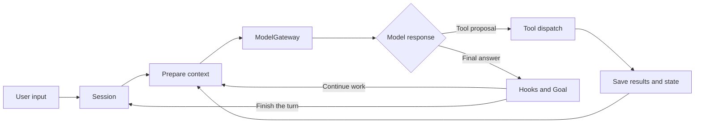

# homebrew-harness design

**English** | [简体中文](DESIGN.zh-CN.md) · [README](../README.md)

homebrew-harness combines a model reasoning loop with execution capabilities. The host selects models, tools, and a working directory. The model proposes actions, and tool results provide evidence for the next turn.

The design centers on three objects: model requests, an effective tool pool, and persistent sessions. Orchestration components build task assignment, fixed workflows, and completion conditions on this foundation.

## Command entry point

`homebrew-harness` provides interactive sessions, persistent tasks, fixed orchestration, and host administration through `session`, `run`, `workflow`, and `admin`. Without a subcommand it starts an automatic interaction host; one-shot tasks use `session`. Shared working-directory and environment-file options may appear before or after subcommands.

The entry point defines shared arguments, parses once, and dispatches to the selected module. Each module owns its state and lifecycle, and execution resources load as needed. The dedicated worker remains an internal Run process entry point.

## Automatic interaction

`InteractionHost` owns the active task reference, input routing and terminal lifecycle. New tasks use a bounded `TaskRouter` proposal, checked against host capabilities and prepared resources. An execution mode and a capability set are separate choices; Workflow remains a composable capability. Session and Run retain their existing loops, state and control owners.

Host input records preserve task identity, input versions and acceptance. Active text steers the frozen task; independent requests queue. Exact commands and displayed request focus route to the existing approval and requirement controllers. Planning results remain reference material beside the original `TaskIntent`.

A settled single-agent Session can hand off to a Run through a closed source checkpoint and an atomic target acceptance. The source context stays intact; the target receives requirements, archive references, known results and the remaining deadline. Its Goal and verification evidence are fresh. Optional detached supervision uses a fixed process entry, a startup ACK and actual leases; reopening attaches to the existing Run.

## Execution flow

`HarnessSession` owns Lead context, input control, shared execution resources, and checkpoints. `LoopComponents` describes the components used by a loop. Preparation assembles the actual tool pool and model input; the main loop handles normalized responses and tool calls.

Host commands inspect state, set goals, authorize actions, and recover execution. User requests enter model context, and steering is applied at tool-batch boundaries. Background, scheduled, and team events arrive through durable inboxes.

## Model integration

`ModelGateway` manages concurrency, deadlines, cancellation, connection state, and usage observations. Protocol adapters prepare requests, aggregate streams, and parse responses into `ModelResponse` and `ToolInvocation`.

Supported protocols are Chat Completions, Responses, DashScope Generation, and Anthropic Messages. Protocol-specific reasoning state lives in attachments owned by its context; ordinary history uses a shared message representation.

The model catalog separates connections from usage profiles. Connections reference external environment variables; profiles declare models, context limits, output limits, and capabilities. Lead, teammate, and subagent roles can select different profiles. Auxiliary calls use the appropriate model entry point. Configuration identity is saved with checkpoints, and the host supplies connection values.

Host model preparation shares the catalog and bindings across entry points, including direct Workflows and live benchmarks. Binding identity includes configuration, API version, capabilities, and effective limits. Model workflows take a complete binding and use the gateway’s protocol preparation for their input and output limits.

Context preparation accounts for the request after adapter expansion and reuses the prepared result. Usage records describe request cost and execution state; the provider manages spending limits.

## Tools and execution

The tool catalog defines descriptions and parameter schemas; handlers implement capabilities. Each turn's effective pool reflects enabled modules, role, and available resources. MCP tools join the same pool.

Dispatch performs parameter validation, pre-tool Hooks, permission checks, action acceptance, handler execution, and post-tool observation. Results enter history. Files, Bash, tests, and MCP use their own executors with shared deadlines, cancellation, and operation records.

File tools support reading, matching, and versioned writes. Bash runs on the host or in a container. TestRunner executes registered recipes and produces receipts linked to code snapshots. MCP discovers and calls external tools over real transports; local stdio services can use a container backend.

Container outputs are collected into bundles using host-registered rules, then published separately to a task workspace. Manifests, content, and publication results provide evidence for subsequent checks.

## Context and knowledge

`TaskIntent` stores the original user request and ordered amendments. History contains model responses, tool results, and execution observations. Separate host state supplies the current constraints.

Skills expose a short catalog first and load instructions on demand. Memory provides optional cross-session recall and maintenance.

The compactor shortens older results under context pressure, archives full content, and can ask the model for a working summary. Tool batches remain complete message groups, and original records remain readable from archives.

Task text and explicit Goal definitions bind independently and commit with the session checkpoint before model work.

Todo represents the current visible plan. Persistent dependencies and completion evidence belong to Tasks and Goals.

## Work organization

| Component | Responsibility |
| --- | --- |
| Subagent | A local delegation with independent context and a returned result |
| Task System | Persistent tasks, dependencies, claims, and completion |
| Agent Teams | Persistent members, messaging, plan review, and assignment |
| Worktree | A separate Git directory bound to a task |
| Background | Command registration, result queries, and completion notices |
| Cron | Delivery of registered requests when time conditions are met |
| Workflow | Host-registered async scripts with saved step results and recovery |
| Goal | User completion conditions, execution evidence, and stop decisions |

Each Workflow execution owns its event loop, run lock, journal, child requests, and serialized state writes. Foreground cancellation and state observation use separate memory controls. A completion receipt binds the final snapshot and output; recovery and retention use that confirmation alongside actual cleanup.

These components reuse the same loop and model gateway. Subagents isolate a local context; teams support ongoing collaboration. Workflows express fixed orchestration, and Tasks express dependencies.

Goals can use natural-language conditions or structured file and test predicates. A stop proposal is checked against current user amendments and execution state before it is committed. A test pass refers to the version actually tested.

## Persistence and recovery

SQLite stores session checkpoints, inboxes, operation records, Tasks, Goals, artifacts, and session lifecycle state. Checkpoints use incremental messages and component versions to reduce repeated history storage. Task state, dependencies, and claims share the database; Memory uses separate knowledge files.

Input acceptance, history application, member delivery, and member application have distinct saved states. History updates, input acknowledgments, and member messages advance at the same transaction boundary. Tool proposals also reference the input version on which they depend.

Operation records track acceptance and results. Known results rejoin the loop; unresolved effects are exposed through recovery inspection. Execution leases represent actual resource occupancy. Closing tracks component shutdown, state persistence, and release completion.

Full tool outputs and transcripts live in archives. GC follows session, task, goal, and artifact references to retain content. Checkpoint retirement turns older, settled sessions into manageable cold records.

## Managed runs

A Run represents a persistent task, an ExecutionAttempt represents its worker process, and an Episode represents a bounded segment of progress. `RunController` connects Session preparation, input, and checkpoints. A normal yield continues the same context; outcomes, input, and Goal decisions share a commit boundary.

`RunSupervisor` manages worker processes, waiting, and recovery. Workers hold actual resource leases; the host decides whether to continue from process, heartbeat, operation, and cleanup facts. Fixed-test authorizations, overall deadlines, and recovery counts persist with the Run. Model usage remains observational.

Deadline retains the source of the active limit. The controller distinguishes request recovery, Episode continuation, and stopping. Persistent members use their own request deadlines and the Run deadline.

Run input recipients stay stable across Episodes and processes. Host controls and business input have separate records, and tool proposals reference input versions. One-shot and interactive Sessions keep their usual entry points; `homebrew-harness run` manages persistent execution.

The `runs/` package contains RunSpec, RunOutcome, SQLite state access, session control, and process supervision. It reuses the existing tools, context, Goals, database, and Task dependency graph.

### External tools in Runs

RunSpec selects server aliases and raw MCP tool names. Host configuration provides transports, connection values, execution backends and tool policies. A shared preparation path assembles selected bindings into the effective pool and saves a stable declaration and schema manifest. Live connections belong to the worker; a new worker reconnects and checks the same manifest.

MCP approvals use the same durable requests, invocation dispatch and action-acceptance transaction as other Run tools. Known responses become tool evidence. Lost read responses remain failed observations, while uncertain writes enter the existing inspection flow. Local stdio services share a fixed resource owner linked to the worker lifeline. The owner closes host process groups or uses the container backend to remove its resources, then records actual release.

Lead owns external capabilities by default. Optional read-only delegation intersects the selected host policies with the child tool scope. Workspace services prepare and reuse connections for each assigned task. Idle scopes release containers when the connection limit needs room; queued and active invocations retain their owners. Automatic routing selects from the host tool catalog, and Session handoff transfers stable declarations after source actors close.

### Permissions and progress

Fixed-test grants are stored by member, task, workspace, and recipe. On expiry or exhaustion, a durable request connects host renewal with member waiting. Grant updates and wake hints commit together; use counts are consumed in the action-acceptance transaction. TestRunner and Goal availability checks share the persistent authorization source. Fresh test receipts verify ordinary source edits.

Human tool approvals and requirement questions use durable requests. Approved calls pass through normal dispatch again; operation acceptance and one-time permission consumption share a transaction. Requirement answers enter the stable user inbox. Progress control uses execution failures and file-state observations to organize local replanning.

### Sources and notifications

Optional PR sources save events, cursors, and reference-inbox delivery together. Reference input and user amendments remain separate; proposals and completion commits check both versions. `RunServices` handles sources, database wake events, and a minimal notification outbox. Notification delivery and business completion have separate results.

### Stage evidence and inputs

Stages directly reference the Task dependency graph. The host freezes stage definitions, and structured checks accept submitted outputs. Task completion and handoff commit together to unlock successors. The final Goal checks delivery conditions and stage evidence.

Managed test receipts reference the Run, task, requirement version, test definition, execution environment, and input snapshot. New processes check receipts against current state. Handoffs contain original requirements, acceptance facts, history references, and model-proposed next steps. Stages normally continue the current session, with full handoffs available on demand.

The host delivers declared predecessor inputs before a task is claimed. Input manifests reference predecessor submissions and content versions. Input overlays and output baselines remain separate; changed inputs invalidate old evidence. A saved manifest connects file effects with task claims.

Snapshots store relevant content, including declared source dependencies linked to acceptance versions. File metadata and Git identity checks detect changes outside the content scope. Content snapshots and inventories have separate scale limits.

### Teams and model handoff

Managed teams use fixed members and stage ownership from RunSpec, executed by TeamManager. Members work in separate worktrees, with recovery counts saved in Run records. Explicit integration collects accepted outputs, checks target versions, and creates a publication manifest. File publication and task acceptance have separate saved results.

Member work segments produce structured outcomes: completed, waiting for input or an event, needing Lead direction, blocked, or failed. Input application, version hints, and checkpoints advance together. Normal input amendments leave infrastructure recovery counts unchanged. Host waiting is driven by actual execution or concrete events; other action items go to the Lead.

Terminal Runs settle unfinished task ownership after resources and unknown effects are resolved, retaining historical results. Explicit resume acknowledgment is saved with updated Gateway observations before the same model continues.

Model handoff creates a new Lead session while preserving Run identity. Original requirements, stage evidence, and session references enter the handoff; protocol-private state stays in its original session. Fallback follows host-declared failure classes. Member bindings, permissions, and the overall deadline remain in effect.

### Export and maintenance

Run exports contain requirements, state, and evidence indexes. Backups taken after safe shutdown combine a consistent SQLite database with an attachment manifest; restoration first creates inspectable state. Session references protect context before and after model handoff. Runtime boundaries check available disk space.

## Capabilities and extension

File visibility and physical path safety have separate checks. Reads, matching, and content search share traversal and access boundaries. Run tool pools reflect host stage declarations, roles, and instantiated resources.

The default `core` profile provides common tools. `Capabilities` enables optional modules, and the effective pool reflects both configuration and instantiated resources.

A new tool typically adds a description/schema, handler, and permission policy. A new model protocol implements the adapter contract; a fixed workflow registers a script. Hosts can compose components through `LoopComponents` in a Session or an independent loop.

Hooks expose extension points at user input, before and after tools, and before finishing. Control Hooks decide whether work continues; observation Hooks support logs, plan display, and statistics.

## Code organization

Persistent services own work acceptance and scheduling while native Runs own agent execution. Their control store records work and Run references; a stable launch intent joins the two stores through the Run API's idempotent acceptance. The Text UI and independent applications use one authenticated HTTP control API. Shared Service and Work views map its queries and commands to the existing controllers. Portable clients depend on contracts and observation; local hosts retain execution ownership and explicit saved-state inspection. Services keep their runtime outside mutable target code.

Repository maintenance separates reliable state from reasoning. Source adapters return bounded pages; the service commits events, work references and cursors together. Prepared Agent Loops use narrow query/proposal tools and packaged skills for triage, discussion and reports. Host policy compiles versioned work authority into native Run settings. Conversation messages and report windows remain service records across execution restarts.

The Python SDK exposes `Harness` and `AsyncHarness` with Session, Run, Workflow, interaction, request, and maintenance services. Execution handles identify the original unit of work and project state from the existing inbox, checkpoints, Run records and Workflow journal. The host manages attached resource ownership; async applications observe the same execution through awaitable views. See [Python API](PYTHON_API.md) for application usage.

| Directory | Responsibility |
| --- | --- |
| `services/` | Persistent service ownership, work queue, schedules, HTTP control and Text UI |
| `api/` | Application services, execution handles, typed decisions and async views |
| `runtime/` | Sessions, loops, input, Hooks, preparation, and host control |
| `runs/` | Persistent Runs, Episodes, outcomes, process supervision, and recovery |
| `execution/` | Model gateway, adapters, processes, containers, Bash, tests, snapshots, and leases |
| `tools/` | Catalog, dispatch, effective pools, and MCP transports |
| `context/` | Task intent, history, compaction, skills, memory, and Todo |
| `orchestration/` | Tasks, teams, worktrees, Workflows, Goals, and event orchestration |
| `storage/` | SQLite, incremental checkpoints, messages, artifacts, backups, and history maintenance |
| `security/` | Permission policies, file access, and output handling |

`cli.py` provides the unified command and `cli_arguments.py` defines shared options. `session_cli.py`, `workflow_cli.py`, `runs/cli.py`, and `admin.py` execute their respective subcommands. Tests follow the same module layout; `integration/` checks composition and `system/` exercises real container execution.

Platform adapters translate repository events and change-request feedback into typed references and bounded pages. Service/Run controllers own acceptance and recovery; platform API paths and authentication stay in platforms/. See [Code platforms](PLATFORMS.md).
