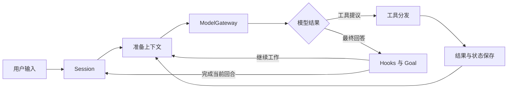

# homebrew-harness 设计

homebrew-harness 将模型的推理循环与具体执行能力组合成一个运行时。宿主选择模型、工具和工作目录；模型提出动作；工具结果进入上下文，形成下一轮推理的依据。

设计围绕三个对象展开：模型请求、有效工具池和持久会话。编排组件在这一基础上表达任务分工、固定流程和完成条件。

## 运行流程

`HarnessSession` 持有 Lead 上下文、输入控制、共享执行资源与 checkpoint。`LoopComponents` 描述一次循环使用的组件，准备阶段组装实际工具池和模型输入。主循环只处理统一的模型结果和工具调用。

宿主命令负责查看状态、设置目标、授权和恢复。普通用户请求进入模型上下文；工作期间的 steering 在工具批次边界应用。后台、定时和团队事件通过持久收件箱进入对应循环。

## 模型接入

`ModelGateway` 管理请求的并发、期限、取消、连接状态和用量观察。适配器负责具体协议的请求转换、流式聚合和响应解析，向循环返回 `ModelResponse` 与 `ToolInvocation`。

当前协议为 Chat Completions、Responses、DashScope Generation 和 Anthropic Messages。协议需要的推理回传保存在所属上下文的附件中；普通历史保持统一消息形式。

模型目录分为连接和用途配置。连接引用外部环境变量，配置声明模型、上下文、输出和能力。Lead、成员和 Subagent 可选不同配置，辅助调用使用对应模型入口。配置身份随 checkpoint 保存，连接值由宿主运行环境提供。

上下文准备会计入适配器展开后的实际请求内容，并复用准备结果。用量记录用于观察请求成本和运行状态，费用控制由提供商管理。

## 工具与执行

工具目录保存描述和参数 schema，handler 提供实现。每轮有效工具池由启用能力、角色和当前资源组成；MCP 工具也进入同一个池。

工具分发依次执行参数检查、前置 Hook、权限判断、动作接受、handler 与后置观察，再将结果加入历史。文件、Bash、测试和 MCP 使用各自执行器，共享期限、取消和操作记录。

文件工具提供读取、匹配和版本化写入。Bash 可运行于宿主或容器；TestRunner 执行登记的 recipe 并生成关联代码快照的结果。MCP 通过真实传输发现和调用外部工具，本地 stdio 服务可使用容器后端。

容器产物先按宿主登记规则收集为 bundle，再单独发布到任务工作区。产物清单、内容和发布结果共同构成后续检查的依据。

## 上下文与知识

`TaskIntent` 保存原始用户要求和有序修订。会话历史包含模型结果、工具结果和运行观察；当前约束由独立宿主状态提供。

技能加载分为目录和正文两层：默认提供简介，用到时读取技能内容。Memory 提供可选的跨会话召回和维护。

压缩器按上下文压力缩短较旧结果、保存完整归档，并在需要时调用模型形成工作摘要。工具批次作为完整消息组处理，归档保留可回读的原始记录。

Todo 表达当前可见计划；它不承担持久任务依赖或完成证明。

## 工作组织

| 组件 | 表达的内容 |
| --- | --- |
| Subagent | 一次局部委派，使用独立上下文并返回结果 |
| Task System | 持久任务、依赖关系、认领和完成 |
| Agent Teams | 持续存在的成员、消息协作、计划审批与分工 |
| Worktree | 与任务绑定的独立 Git 工作目录 |
| Background | 慢命令的登记、结果查询和完成通知 |
| Cron | 根据时间条件将登记的请求送入执行循环 |
| Workflow | 宿主登记的固定异步脚本、步骤结果和恢复 |
| Goal | 用户完成条件、执行证据与结束判断 |

这些组件复用同一循环和模型入口。一次性委派侧重隔离局部上下文，团队侧重持续协作；Workflow 表达固定编排，Task 表达依赖关系。

Goal 可以使用自然语言条件，也可以使用文件与测试的结构化条件。结束判断先形成候选决定，再结合当前用户修订和执行状态提交结果。测试通过记录对应实际被测版本。

## 持久状态与恢复

SQLite 保存会话 checkpoint、inbox、操作记录、Task、Goal、产物及会话生命周期。checkpoint 使用增量消息与组件版本，减少重复保存历史正文。Task 的状态、依赖与认领保存在同一数据库；Memory 使用独立知识文件。

输入被接受、加入历史、投递给成员和成员实际应用都有对应状态。历史更新、输入确认和成员消息在同一事务边界推进；工具提议也关联它所依据的输入版本。

操作记录保存接受与执行结果。正常结果继续进入循环，尚待确认的结果由恢复入口呈现。执行租约标识资源的实际占用，关闭过程跟踪组件停止、状态保存和释放完成。

完整工具输出和 transcript 保存在归档区。GC 从会话、任务、目标和产物的引用关系确定保留内容；checkpoint 退休将较旧且已结清会话转为可管理的冷记录。

## 受管理运行

Run 表达一个持久任务，ExecutionAttempt 表达当前执行进程，Episode 表达会话中的一段有界推进。`RunController` 接入 Session 的准备、输入和 checkpoint；正常 yield 后继续原上下文，运行结果与输入、Goal 在同一提交边界保存。

`RunSupervisor` 管理执行进程、等待与恢复。执行者保留实际资源租约，宿主根据进程、心跳、操作和收尾事实决定是否接续。固定测试授权、总期限与恢复计数随 Run 保存，模型用量仍用于观察。 Deadline 保留实际起作用的期限来源，控制器据此安排请求恢复、Episode 接续或停止；持续成员使用自身请求期限与 Run 期限。

Run 的输入收件人跨执行段和进程保持稳定。宿主控制与业务输入分别登记；工具提议关联输入版本。正常单次/交互 Session 继续使用原入口，受管理执行通过 `harness-run` 组织。

`runs/` 包保存 RunSpec、RunOutcome、SQLite 状态适配、会话控制和进程监督。它复用已有工具、上下文、Goal 和数据库，不维护另一套工作依赖图。

固定测试许可按成员、任务、工作区和 recipe 保存；到期或耗尽时，持久请求连接宿主续期与成员等待。许可更新和唤醒一起提交，使用次数在动作接受事务中消费。TestRunner 使用持久许可的运行时投影，普通源码编辑继续由新的测试凭证验证。

人工工具审批与需求问题保存为持久请求。工具批准通过统一分发层重新核验，接受操作与一次性授权消费同事务提交；需求回答通过稳定用户 inbox 应用。进展控制使用执行失败和文件状态等事实组织局部重规划。

可选 PR 来源将事件、读取位置和 reference inbox 投递一起保存。参考输入与用户修订分开，模型提议和完成提交核对两者版本。`RunServices` 处理来源、同库 wake 和最小通知 outbox；通知结果与业务完成分别记录。

阶段直接引用 Task DAG。宿主冻结阶段定义，模型提交产物后，由硬条件检查形成验收记录；Task 完成与阶段交接在同一事务中保存，下游由此解锁。最终 Goal 同时核对交付条件和各阶段证据。

受管理测试凭证关联 Run、任务、需求版本、测试定义、执行环境和输入快照。新进程读取凭证并核对当前状态，阶段交接保存原始要求、验收事实、历史引用和模型提出的下一步。阶段通常继续当前会话，完整交接可按需回读。

阶段的声明输入由宿主在认领前交付，清单绑定前驱 submission 与内容版本。消费者的输入覆盖层和产物基线分别保存，输入变更会使旧证明失效。文件效果与任务认领通过已保存的输入清单连接。 阶段快照只保存有关内容；声明的源码依赖也关联验收版本。范围外使用文件元数据与 Git 身份检查变更，内容与清单分别保留规模上限。

受管理团队使用 RunSpec 中的固定成员与阶段归属，继续由 TeamManager 执行。成员在独立 worktree 中工作，恢复计数保存在 Run 记录中。显式集成收集已验收产物，核对目标版本并生成发布清单；多文件发布结果与任务验收分别保存。

成员工作段保存结构化结果：等待输入、等待具体事件、需要 Lead 指示、完成或阻塞。输入应用、版本提示和 checkpoint 共同推进，正常修订不消耗故障恢复次数。宿主等待只用于真实执行或明确事件，其余待办进入 Lead 决策。

终态 Run 在真实资源和未知效果结清后结束未完成节点的归属，保留历史结果。显式恢复确认与新的 Gateway 观察一起保存，随后接续同一模型。

模型交接创建新的 Lead 会话，Run 保持稳定身份。原始要求、阶段证据与会话引用进入交接，协议私有内容保留在原会话中。备用策略按宿主声明的故障类别推进，成员绑定、权限范围与总期限继续沿用原配置。

Run 导出提供要求、状态与证据索引。安全停靠后的备份组合一致性 SQLite 数据库和附件清单；恢复先重建可检查状态。会话引用保护覆盖模型交接前后的上下文，磁盘余量在业务边界检查。

## 能力组合与扩展

默认 core 提供常用工具，可选模块由 `Capabilities` 启用。有效能力与实际组件共同决定模型看到的工具，避免工具目录与资源实例分离。

新增工具通常只需要描述/schema、handler 和权限策略。新增模型协议实现适配器契约；新增固定编排注册 Workflow 脚本。宿主可使用 `LoopComponents` 将自定义组件接入 Session 或独立循环。

Hooks 在用户输入、工具前后和准备结束时提供扩展点。控制 Hook 决定是否继续，观察 Hook 用于日志、计划展示和统计。

## 代码组织

| 目录 | 职责 |
| --- | --- |
| `runtime/` | Session、循环、输入、Hooks、组件准备和宿主控制 |
| `runs/` | 持久任务、Episode、结构化结果、进程监督与恢复 |
| `execution/` | 模型网关、协议适配器、进程、容器、Bash、测试与执行租约 |
| `tools/` | 工具目录、分发、有效工具池和 MCP 传输 |
| `context/` | 任务原文、历史、压缩、技能、记忆和 Todo |
| `orchestration/` | Task、Team、Worktree、Workflow、Goal、后台事件编排 |
| `storage/` | SQLite、增量 checkpoint、消息、产物、备份和历史维护 |
| `security/` | 权限策略、文件访问和输出数据处理 |

`cli.py`、`workflow_cli.py`、`runs/cli.py` 和 `admin.py` 分别提供会话、固定工作流、受管理运行与宿主管理入口。测试按相同模块组织，`integration/` 验证组件协作，`system/` 验证真实容器执行。
