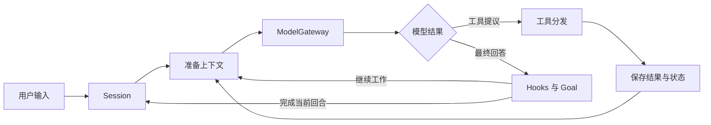

# homebrew-harness 设计

[English](DESIGN.md) | **简体中文** · [README](../README.zh-CN.md)

homebrew-harness 将模型推理循环与执行能力组合成运行时。宿主选择模型、工具和工作目录；模型提出动作；工具结果为下一轮提供证据。

设计围绕三个对象展开：模型请求、有效工具池和持久会话。编排组件在此基础上表达任务分工、固定流程和完成条件。

## 命令入口

`homebrew-harness` 通过 `session`、`run`、`workflow`、`admin` 四个子命令提供交互会话、持久任务、固定编排和宿主管理。无子命令时启动自动交互宿主，单次任务使用 `session`。公共工作目录和环境文件选项可放在子命令前后。

入口统一定义公共参数、解析一次并分发给相应执行模块。各模块继续拥有自己的状态与生命周期，运行资源按执行需要加载。独立 worker 是 Run 的内部进程入口。

## 自动交互

`InteractionHost` 管理活动任务引用、输入分流和终端生命周期。新任务通过有界 `TaskRouter` 提议选择执行方式与能力，再核验宿主目录和已准备资源。执行模式与能力集合是独立维度，Workflow 仍是可组合能力。Session 和 Run 继续拥有原有循环、业务状态与控制逻辑。

宿主输入记录保留任务身份、输入版本与受理事实。活动任务的普通文字修订已冻结任务，独立请求排队。精确命令与已展示请求焦点交给原有审批和需求控制器；规划结果作为参考，与原始 `TaskIntent` 并存。

已收尾的单 Agent Session 可通过源 checkpoint 与目标原子接受接续为 Run。原上下文保持完整，目标承接需求、归档引用、已知结果和剩余期限，使用新的 Goal 与验证证据。可选独立 supervisor 使用固定进程入口、启动 ACK 和真实租约；重新打开入口附着已有 Run。

## 执行流程

`HarnessSession` 持有 Lead 上下文、输入控制、共享执行资源与 checkpoint。`LoopComponents` 描述循环使用的组件。准备阶段组装实际工具池和模型输入，主循环处理统一的响应和工具调用。

宿主命令负责查看状态、设置目标、授权和恢复。用户请求进入模型上下文，steering 在工具批次边界应用。后台、定时和团队事件通过持久 inbox 到达。

## 模型接入

`ModelGateway` 管理并发、期限、取消、连接状态和用量观察。协议适配器准备请求、聚合流并将响应解析为 `ModelResponse` 与 `ToolInvocation`。

支持 Chat Completions、Responses、DashScope Generation 和 Anthropic Messages。每种协议的 HTTP 与可选 SDK 执行器共用请求和响应转换。连接准备时确定后端，网关继续拥有请求执行和工具调用边界。协议专用的思考状态保存在所属上下文的附件中，普通历史使用共享消息表示。

模型目录将连接与用途配置分开。连接引用外部环境变量，配置声明模型、上下文、输出和能力。Lead、成员和 Subagent 可选不同配置，辅助调用使用相应模型入口。配置身份随 checkpoint 保存，连接值由宿主提供。

宿主模型准备由各入口共用模型目录和绑定，直接 Workflow 与 live benchmark 使用同一协议接入。绑定身份包含配置、API 版本、能力、有效限制和实际后端。恢复沿用已保存的后端；原 SDK 不可用时，需要恢复对应环境或创建新执行。模型型 Workflow 接收完整绑定，通过网关的协议准备路径核查输入与输出限制。

上下文准备计入适配器展开后的请求，并复用准备结果。用量记录描述请求成本和执行状态，费用上限由提供商管理。

## 工具与执行

工具目录定义描述与参数 schema，handler 实现能力。每轮有效工具池反映启用模块、角色和可用资源，MCP 工具加入同一工具池。

分发依次执行参数检查、前置 Hook、权限检查、动作接受、handler 和后置观察。结果进入历史。文件、Bash、测试和 MCP 使用各自执行器，共享期限、取消和操作记录。

文件工具支持读取、匹配和版本化写入。Bash 在宿主或容器运行，TestRunner 执行登记的 recipe 并生成关联代码快照的凭证。MCP 通过真实传输发现和调用外部工具，本地 stdio 服务可以使用容器后端。

容器产物按宿主登记规则收集为 bundle，再单独发布到任务工作区。清单、内容和发布结果为后续检查提供证据。

## 上下文与知识

`TaskIntent` 保存原始用户请求和有序修订。历史包含模型响应、工具结果和运行观察，独立宿主状态提供当前约束。

Skill 先暴露简短目录，再按需读取正文。Memory 提供可选跨会话召回与维护。

压缩器在上下文压力下缩短较旧结果、归档完整内容，并可请求模型生成工作摘要。工具批次保持完整消息组，原始记录可从归档回读。

任务正文与显式 Goal 分别绑定，并与会话 checkpoint 一起提交；原始约束先于模型工作保存。

Todo 表达当前可见计划，持久依赖与完成证据由 Task 和 Goal 负责。

## 工作组织

| 组件 | 职责 |
| --- | --- |
| Subagent | 独立上下文中的局部委派，返回结果 |
| Task System | 持久任务、依赖、认领和完成 |
| Agent Teams | 持续成员、消息、计划审批和分工 |
| Worktree | 与任务绑定的独立 Git 目录 |
| Background | 命令登记、结果查询和完成通知 |
| Cron | 时间条件满足时投递登记的请求 |
| Workflow | 宿主登记的异步脚本、步骤结果和恢复 |
| Goal | 用户完成条件、执行证据和结束判断 |

Workflow 每次执行持有自己的事件循环、运行锁、journal、子请求，并串行写入状态。前台取消和状态读取使用独立的内存控制；完成凭证关联最终快照与输出，恢复和保留策略结合该确认及实际收尾情况作出判断。

组件复用同一循环和模型网关。Subagent 隔离局部上下文，团队支持持续协作；Workflow 表达固定编排，Task 表达依赖。

Goal 可用自然语言条件或结构化文件、测试谓词。结束提议在提交前核对当前修订和执行状态，测试通过对应实际被测版本。

## 持久状态与恢复

SQLite 保存会话 checkpoint、inbox、操作、Task、Goal、产物和会话生命周期。checkpoint 使用增量消息与组件版本，减少重复保存历史。任务状态、依赖与认领共用数据库，Memory 使用独立知识文件。

输入接受、历史应用、成员投递和成员应用有独立保存状态。历史更新、输入确认和成员消息在同一事务边界推进，工具提议引用其依赖的输入版本。

操作记录跟踪接受与结果。已知结果重新进入循环，未确认效果通过恢复检查呈现。执行租约表达真实资源占用，关闭跟踪组件停止、状态保存和释放完成。

完整输出和 transcript 保存在归档中。GC 沿会话、任务、目标和产物引用保留内容，checkpoint 退休将较旧且已结清会话转为可管理冷记录。

## 受管理运行

Run 表达持久任务，ExecutionAttempt 表达执行进程，Episode 表达一段有界推进。`RunController` 接入 Session 的准备、输入和 checkpoint。正常 yield 后接续同一上下文，结果、输入和 Goal 决定共用提交边界。

`RunSupervisor` 管理进程、等待和恢复。执行者持有真实资源租约，宿主根据进程、心跳、操作和收尾事实决定接续。固定测试许可、总期限与恢复计数随 Run 保存，模型用量继续用于观察。

Deadline 保留当前限制来源，控制器区分请求恢复、Episode 接续与停止。持续成员使用自身请求期限和 Run 期限。

Run 输入收件人跨段落和进程保持稳定。宿主控制与业务输入分别登记，工具提议引用输入版本。单次与交互 Session 保留常规入口，`homebrew-harness run` 管理持久执行。

`runs/` 包包含 RunSpec、RunOutcome、SQLite 状态访问、会话控制和进程监督，复用已有工具、上下文、Goal、数据库与 Task 依赖图。

### Run 的外部工具

RunSpec 选择服务器别名与原始 MCP 工具名。宿主配置提供传输、连接值、执行后端与工具策略。共同的准备入口把选中的 binding 装入有效工具池，保存稳定声明与 schema manifest。活连接属于 worker，新 worker 重新连接并核验相同 manifest。

MCP 审批沿用其他 Run 工具的持久请求、调用分发和动作接受事务。已知响应进入工具证据；丢失的读取响应保持失败事实，结果不确定的写入进入已有检查流程。本地 stdio 服务共用固定资源 owner，通过存活通道关联 worker。owner 关闭宿主进程组或调用容器后端移除资源，再保存实际释放事实。

Lead 默认持有外部能力；可选只读委派将选中的宿主策略与子循环工具范围取交集。工作区服务按实际任务准备并复用连接，达到连接上限时释放空闲容器；排队和活动调用继续保留归属。自动路由从宿主工具目录选择能力，Session 交接在源 Actor 关闭后承接稳定声明。

### 权限与进展

固定测试许可按成员、任务、工作区和 recipe 保存。到期或耗尽时，持久请求连接宿主续期与成员等待。许可更新和唤醒一起提交，次数在动作接受事务中消费。TestRunner 与 Goal 的可用性查询使用同一持久许可来源，普通源码编辑由新的测试凭证验证。

人工工具审批与需求问题使用持久请求。批准的调用重新经过正常分发，操作接受和一次性许可消费同事务保存；需求答复进入稳定用户 inbox。进展控制根据执行失败和文件状态组织局部重规划。

### 来源与通知

可选 PR 来源将事件、读取位置与 reference inbox 投递一起保存。参考输入与用户修订保持独立，提议和完成提交核对两种版本。`RunServices` 处理来源、数据库唤醒和最小通知 outbox，通知送达与业务完成分别记录。

### 阶段证明与输入

阶段直接引用 Task 依赖图。宿主冻结阶段定义，结构化检查验收提交产物。Task 完成和交接一起提交以解锁后继，最终 Goal 核对交付条件与阶段证明。

受管理测试凭证引用 Run、任务、需求版本、测试定义、执行环境与输入快照。新进程核对当前状态；交接包含原始要求、验收事实、历史引用和模型提出的下一步。阶段通常继续当前会话，完整交接按需读取。

宿主在任务认领前交付声明的前驱输入，清单引用前驱 submission 与内容版本。输入覆盖层和产物基线分开，输入变化使旧证据失效。已保存清单连接文件效果与任务认领。

快照保存相关内容，包括关联验收版本的声明源码依赖。文件元数据和 Git 身份检查发现内容范围外变化，内容快照与清单分别设定规模上限。

### 团队与模型交接

受管理团队使用 RunSpec 中的固定成员和阶段归属，由 TeamManager 执行。成员在独立 worktree 工作，恢复计数随 Run 保存。显式集成收集已验收产物，核对目标版本并创建发布清单；文件发布和任务验收有独立保存结果。

成员工作段产生结构化结果：完成、等待输入或事件、需要 Lead 指示、阻塞或失败。输入应用、版本提示与 checkpoint 一起推进。普通修订不改变基础设施恢复次数；宿主等待依据真实执行或具体事件，其他待办交给 Lead。

终态 Run 在资源和未知效果结清后结束未完成任务归属，保留历史结果。显式 resume 确认与新 Gateway 观察一起保存，再接续同一模型。

模型交接创建新的 Lead 会话并保留 Run 身份。原始要求、阶段证据与会话引用进入交接，协议私有状态留在原会话。备用策略遵循宿主声明的故障类别，成员绑定、权限和总期限继续有效。

### 导出与维护

导出包含要求、状态和证据索引。安全关闭后的备份组合一致性 SQLite 数据库与附件清单，恢复先生成可检查状态。会话引用保护模型交接前后上下文，运行边界检查可用磁盘空间。

## 能力与扩展

文件可见性与物理路径安全分别校验，读、匹配和搜索共用遍历与权限边界。Run 工具池按宿主阶段声明、角色和实际资源生成。

默认 `core` 提供常用工具，`Capabilities` 启用可选模块，有效工具池同时反映配置与已实例化资源。

新增工具通常添加描述／schema、handler 和权限策略；新增模型协议实现适配器契约，固定流程登记 Workflow 脚本。宿主可用 `LoopComponents` 在 Session 或独立循环中组合组件。

Hooks 在用户输入、工具前后和结束前提供扩展点。控制 Hook 决定是否继续，观察 Hook 支持日志、计划展示和统计。

## 代码组织

持久 Service 管理工作受理与调度，原生 Run 负责 Agent 执行。控制库保存工作和 Run 引用，通过稳定启动意图与 Run API 的幂等受理关联两份状态。Text UI 与独立程序使用统一认证 HTTP 控制 API，共用 Service／Work 视图将查询和命令映射到已有控制器。轻量客户端依赖契约与观察层，宿主保留执行归属和显式保存状态检查。运行时位于可变目标源码之外。

仓库维护将可靠状态与模型研判分开。Source 适配器返回有界页，服务在同一事务中受理事件、工作引用和游标。已有 Agent Loop 装配窄查询/提议工具与内置 Skill，完成研判、对话和汇报；宿主将版本化工作授权编译为原生 Run 配置。对话消息和报告窗口独立于某次执行持久保存。

Python SDK 通过 `Harness` 和 `AsyncHarness` 提供 Session、Run、Workflow、自动入口、请求和维护服务。执行句柄标识原始工作单位，从现有 inbox、checkpoint、Run 记录和 Workflow journal 投影状态。宿主管理附着执行的资源归属，异步应用通过可等待视图观察同一执行。应用用法见 [Python API](PYTHON_API.zh-CN.md)。

| 目录 | 职责 |
| --- | --- |
| `services/` | 持久服务归属、工作队列、调度、HTTP 控制和 Text UI |
| `api/` | 应用服务、执行句柄、类型化决定和异步视图 |
| `runtime/` | Session、循环、输入、Hooks、准备和宿主控制 |
| `runs/` | 持久 Run、Episode、结果、进程监督和恢复 |
| `execution/` | 模型网关、适配器、进程、容器、Bash、测试、快照和租约 |
| `tools/` | 目录、分发、有效工具池和 MCP 传输 |
| `context/` | 任务要求、历史、压缩、技能、记忆和 Todo |
| `orchestration/` | Task、Team、Worktree、Workflow、Goal 和事件编排 |
| `storage/` | SQLite、增量 checkpoint、消息、产物、备份和历史维护 |
| `security/` | 权限策略、文件访问和输出处理 |

`cli.py` 提供统一命令，`cli_arguments.py` 定义公共选项；`session_cli.py`、`workflow_cli.py`、`runs/cli.py` 和 `admin.py` 执行各自的子命令。测试遵循相同模块布局，`integration/` 检查组件组合，`system/` 验证真实容器执行。

平台适配器将仓库事件和变更请求反馈转换为类型化引用和有界页，Service/Run 控制器持有受理与恢复状态；平台路径和认证留在 platforms/。参见 [代码管理平台](PLATFORMS.zh-CN.md)。

社区沟通保存长期议题、有界轮次和需求草案。固定 PR 快照提供审查输入，独立授权的发言动作复用外部效果状态转换。Skill 指导讨论和审查，运行时控制版本、发布和恢复。

Service 的 job contract 统一选择各任务的输入、证据引用、指令、候选验证与事务结果应用，并共用 Agent Loop。对话使用截至当前消息的同 context 历史和明确关联 Work 的证据；报告使用冻结活动窗口及其引用。正式接受的讨论需求保存为独立不可变记录，当前观察单独更新。准备与发布只应用于仍有效的版本。社区沟通与代码交付共用外部效果分类、查证回执和测试资源持有规则；有界清理在真实释放前保留租约。

Service 交付发布审查分支与变更请求，默认观察维护者合并；可选服务合并使用固定 head 的原生平台动作和明确批准。集成回执绑定实际内容、原始条件与验证；合并事实、Work 完成和本地同步分别保存。
